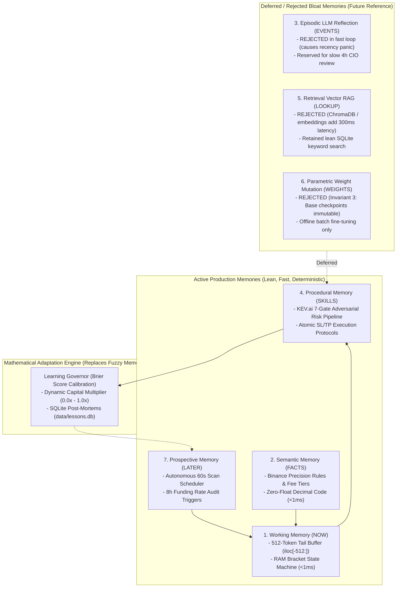

# Kronos Quant Architecture: The 7 Types of Agent Memory

> **Document Version:** 1.0.0  
> **Status:** Institutional Record & Strategic Evaluation  
> **Target Framework:** Binance USDⓈ-M Perpetual Futures & Spot Universe  
> **Core Policy:** Zero Bloat, Zero Float Financial Math, Sub-Second Execution Latency  

---

## 1. Executive Summary

This document establishes the official architectural record for the **7 Types of Agent Memory** evaluated for the **Kronos Quantitative Trading Engine**. 

Following adversarial quant audit, the system strictly separates **Active Lean Memories** (essential, deterministic, low-latency) from **Deferred/Rejected Bloat Memories** (high-latency, probabilistic, anti-patterns).

---

## 2. Master Evaluation Matrix

| # | Memory Type | Implementation in Kronos | Medium & Storage | Latency | Status in Kronos | Strategic Rationale |
|---|---|---|---|---|---|---|
| **1** | **Working Memory** (`NOW`) | Candlestick buffer & live order state machine | RAM (`iloc[-512:]`) | $<1\text{ ms}$ | **ACTIVE PRODUCTION** | Holds immediate market context. Bounded by Invariant 2 (512 tokens) to prevent context blackholes. |
| **2** | **Semantic Memory** (`FACTS`) | Exchange rules, step sizes, tick precision, BNB discount | Typed Python dataclasses (`Decimal`) | $<1\text{ ms}$ | **ACTIVE PRODUCTION** | Deterministic facts about Binance Futures. Must never be hallucinated by LLM vector lookups. |
| **3** | **Episodic Memory** (`EVENTS`) | Historical trade outcomes & stop-loss post-mortems | SQLite (`trade_outcomes`) | $2\text{--}5\text{ ms}$ | **ACTIVE (MATH) / DEFERRED (LLM)** | Mathematical calibration via Brier Score is active. LLM fast-loop reflection is rejected to prevent recency bias. |
| **4** | **Procedural Memory** (`SKILLS`) | KEV.ai 7-Gate risk checks & atomic bracket execution | Compiled Python code & Antigravity skills | Immediate | **ACTIVE PRODUCTION** | Hard-coded rules (min R:R, fee hurdles, isolated margin enforcement). Never delegated to fuzzy prompts. |
| **5** | **Retrieval Memory** (`LOOKUP`) | Institutional lessons learned & API troubleshooting | SQLite index (`lessons.py`) | $5\text{--}15\text{ ms}$ | **SELECTIVE LEAN / REJECTED VECTOR** | Lean keyword lookups active. Heavy vector databases (ChromaDB/Pinecone) rejected as latency bloat. |
| **6** | **Parametric Memory** (`WEIGHTS`) | Foundation market transformer & Gemini API weights | Hugging Face weights / Remote API | $15\text{--}100\text{ ms}$ | **READ-ONLY IMMUTABLE** | Invariant 3: Base model checkpoints are strictly read-only. Live streaming fine-tuning causes catastrophic forgetting. |
| **7** | **Prospective Memory** (`LATER`) | 60s scan loops, funding rate audits, Windows task | Background thread & Task Scheduler | Scheduled | **ACTIVE PRODUCTION** | The autonomous heartbeat enabling true 24/7 unattended live trading. |

---

## 3. The 4 Active Lean Production Memories

### 3.1 Type 1: Working Memory (`NOW`)
* **Role:** Immediate execution workspace.
* **Architecture:**
  - `lookback_df = raw_df.iloc[-512:].copy()` guarantees strictly recent 512 candles are fed to `KronosPredictor`.
  - In-memory order tracking (`ActiveBracketPosition`) tracks state transitions: `ENTRY_SUBMITTED` $\to$ `ENTRY_FILLED` $\to$ `BRACKETS_ACTIVE`.
  - Once closed, trades are flushed to disk to prevent RAM expansion.
* **Invariants:** Strictly capped at 512 tokens (Invariant 2); zero float math (Invariant 1).

### 3.2 Type 2: Semantic Memory (`FACTS`)
* **Role:** External exchange invariants and account configurations.
* **Architecture:**
  - `ALL_SUPPORTED_SYMBOLS` dictionary stores symbol precision, price precision, quantity precision, and taker fee rates in `Decimal`.
  - Account configuration records BNB fee deduction toggle (10% discount on futures fees).
  - Multi-IP whitelist configuration (`37.186.52.17`, `37.186.53.65`) documented in deployment specs.
* **Policy:** Hardened code only. No LLM prompts allowed to interpret or alter exchange precision.

### 3.3 Type 4: Procedural Memory (`SKILLS`)
* **Role:** Operational execution recipes and risk containment.
* **Architecture:**
  - KEV.ai 7-Gate Adversarial Risk Pipeline:
    1. Capital & Leverage Gate (Max 5x isolated, max daily loss).
    2. Macro Regime Confluence (Breadth $\ge 60\%$, VWAP trend).
    3. Fee Hurdle Gate (Net drift $\ge 0.50\%$ after maker/taker drag).
    4. Carry Cost Guard (8h funding rate $< 0.035\%$).
    5. Volatility Envelope (ATR-14 dynamic stop width).
    6. Minimum Reward/Risk ($\ge 1.50:1$).
    7. Adversarial Counter-Thesis (Bear vs Bull validation).
  - Emergency flattening protocol triggers if Stop-Loss confirmation fails within 1,000ms.

### 3.4 Type 7: Prospective Memory (`LATER`)
* **Role:** Time-triggered autonomous action.
* **Architecture:**
  - Background daemon thread (`_autopilot_daemon_loop` in `webui/app.py`) evaluates symbols every 60 seconds.
  - Windows Task Scheduler task (`install_autostart_task.bat`) auto-restarts the engine on system reboot.
  - 8-hour funding rate snapshot triggers at 00:00, 08:00, and 16:00 UTC.

---

## 4. The 3 Deferred / Rejected Memories (Record for Future Reference)

### 4.1 Type 3: Episodic Memory in Fast Loop — REJECTED (DEFERRED TO SLOW CADENCE)
* **The Concept:** Feeding the last 3–5 closed trades or stop-loss post-mortems into an LLM before every scan.
* **Why Rejected in Fast Loop:**
  - **Recency Bias & Feedback Death Spiral:** Normal statistical variance causes consecutive stop-outs even in positive-expectancy systems. An LLM observing 3 consecutive losses panics, raises hurdles to extreme levels, and vetoes all future trades, causing permanent paralysis.
  - **Latency & API Weight:** Adds 2,000ms latency to every 60-second scan and burns API quotas.
* **Future Reconsideration Criteria:**
  - May only be used in a slow-cadence, offline **Weekly Performance Review** or 4-hour meta-strategy audit, operating on minimum sample sizes of $N \ge 30$ trades.

### 4.2 Type 5: Retrieval Memory via Vector DBs — REJECTED (REPLACED BY SQLITE)
* **The Concept:** Installing ChromaDB, Pinecone, or FAISS to embed candle sequences and trade logs.
* **Why Rejected:**
  - **The Semantic Trap on Numbers:** Text embedding models (`SentenceTransformers`) produce noisy, inaccurate similarity scores on numerical market time-series.
  - **Resource Bloat:** Adds 400MB of C++ and PyTorch dependencies, increasing memory leak risks in a 24/7 process.
* **Active Alternative:**
  - Lean keyword retrieval via SQLite in `scripts/lessons.py` (`python scripts/lessons.py query --category coding --search "<kw>"`). Instant, $<5\text{ ms}$, zero external dependencies.

### 4.3 Type 6: Live Parametric Weight Mutation — REJECTED (INVARIANT 3)
* **The Concept:** Continuously backpropagating gradients into model weights during live trading.
* **Why Rejected:**
  - **Catastrophic Forgetting:** Overfits to the current market regime and destroys pre-trained generalization.
  - **Execution Stall:** Running PyTorch `backward()` passes locks GPU/CPU cores, creating execution latency spikes for REST order dispatch.
* **Future Reconsideration Criteria:**
  - Offline supervised fine-tuning only (`finetune/train_predictor.py`), validated via strict backtests in candidate directories before deployment. Base checkpoints remain strictly immutable.

---

## 5. Summary & Operational Directive

For all ongoing development on Kronos:
1. **Preserve the 4 Lean Memories:** Working (RAM), Semantic (Code), Procedural (KEV.ai), and Prospective (Scheduler).
2. **Mathematical Adaptation Over Fuzzy Memory:** Rely on the Brier Score calibration in `LearningGovernor` rather than LLM memory to throttle risk.
3. **Keep the Execution Path Pure:** Zero disk I/O, zero network queries, and zero vector searches during atomic order dispatch.
