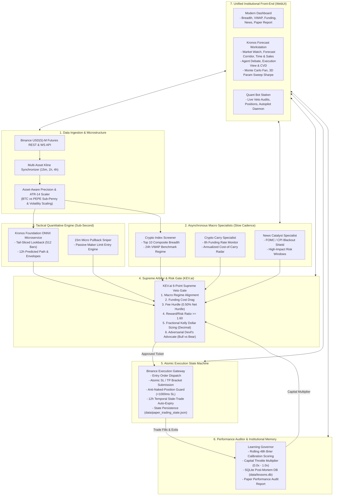

# Kronos Institutional Quant Architecture & Multi-Agent Engine

> **Document Version:** 2.4.0  
> **Target Framework:** Binance USDⓈ-M Perpetual Futures & Spot Universe  
> **Core Alpha Engine:** `NeoQuasar/Kronos-base` (102.3M parameters, 512 context length)  
> **Risk Arbiter:** KEV.ai 6-Point Supreme Veto Gate & Bayesian Brier Learning Engine  
> **Strategy Copilot:** Gemini Free Tier Meta-Strategy Arbiter (`gemini-3.8-flash`)  
> **Execution Baseline:** Small-Account Micro-Trading Engine ($200.00 USDT Paper Equity)  
> **Terminal:** Unified 3-in-1 Bloomberg/Terminal-Grade Front-End (`http://localhost:7070`)

---

## 1. Executive Summary

Kronos is an institutional-grade quantitative trading and forecasting platform. Rather than relying on simple technical indicators or uncalibrated language model sentiment, Kronos synergizes:
1. **The Kronos Foundation Model:** Autoregressive time-series transformer for 12-hour candlestick trajectory generation and dynamic volatility envelopes.
2. **Decoupled Asynchronous Macro Specialists:** Continuous surveillance of macroeconomic catalysts (CPI/FOMC blackout shield), perpetual funding carry economics, and 24h market breadth.
3. **KEV.ai Risk Arbiter & Supreme Veto Gate:** A 6-point mathematical veto gate that audits every proposed ticket for trend alignment, funding drag, exchange fee hurdles ($\ge 0.50\%$), minimum 1.60:1 reward/risk, and adversarial Bull/Bear contradictions.
4. **The Learning Governor:** An empirical calibration engine that scores rolling 48-hour forecasts using Brier probability loss, throttles risk capital ($0.0\text{x}-1.0\text{x}$), and logs post-mortems into an SQLite institutional database (`data/lessons.db`).
5. **Small-Account Micro-Trading & State Persistence Engine:** $200.00 USDT starting equity baseline with 1.5% max risk budgeting, full position and trade history persistence in `data/paper_trading_state.json`, and bot settings memory in `data/bot_settings.json`.
6. **Atomic Execution State Machine:** Failsafe bracket order execution with an Anti-Naked-Position Guard (1,000ms SL timeout emergency flatten) and a 12-Hour Temporal Stale-Trade Expiry.
7. **Institutional Dynamic Chart & Multi-Pane Workstation:** A dynamic front-end replicating institutional prop execution suites, featuring:
   - Dynamic Drag-to-Pan & Zoom across time and price axes.
   - Radiant Golden Monte Carlo Trajectory Fan (1,000 futures paths) radiating from current candle close with P(up)=0.275 and P(down)=0.725 conviction tags.
   - Real-time countdown timer (T-50:04) and floating price beacon (NOW $77,859).
   - Three modular draggable sub-panes: 01 Heat Map (depth ladder), 02 Flow (dual CVD mountain area chart), and 03 Agent Sim Log (Monte Carlo execution stream with one-click `> place the paper order` automated dispatch).
   - Resizable horizontal and vertical splitters for fluid layout adjustment.

---

## 2. System Architecture



---

## 3. Core Architectural Modules (`src/quant/`)

### 3.1 Quantitative Configuration (`src/quant/config.py`)
* **Dual Universe Support:**
  * `TOP_10_SYMBOLS`: Institutional high-liquidity benchmark universe (`BTCUSDT`, `ETHUSDT`, `SOLUSDT`, `BNBUSDT`, `XRPUSDT`, `DOGEUSDT`, `ADAUSDT`, `AVAXUSDT`, `LINKUSDT`, `SUIUSDT`).
  * `EXTENDED_MEME_UNIVERSE`: High-beta micro-penny meme assets (`1000PEPEUSDT` futures at 7 decimals, `PEPEUSDT` spot at 8 decimals).
* **Asset-Specific Formatting & Step Sizes:**
  * Defines exact `price_precision`, `quantity_precision`, `tick_size`, and `step_size` per contract.
  * Ensures zero float truncation errors when dispatching orders to Binance exchange filters (`LOT_SIZE`, `PRICE_FILTER`).
* **Small-Account Micro-Trading Parameters:**
  * `initial_account_equity = Decimal("200.00")`
  * `max_risk_pct_per_trade = Decimal("0.015")` (1.5% max risk per trade = $3.00 risk budget)
  * `max_leverage = Decimal("5.0")`

### 3.2 Macro Specialists (`src/quant/macro_specialists.py`)
* **`NewsCatalystSpecialist`:**
  * Maintains an economic calendar for FOMC rate decisions, CPI releases, Non-Farm Payrolls (NFP), and regulatory events.
  * Implements `is_blackout_active()`: Automatically imposes a hard blackout $\pm 30$ minutes around Tier 1 announcements, suppressing all new trade entries.
* **`CryptoCarrySpecialist`:**
  * Polls Binance perpetual 8-hour funding rates.
  * Calculates annualized carry rates ($R_{\text{annual}} = R_{8\text{h}} \times 3 \times 365$).
  * Classifies carry status (`FAVORABLE`, `NEUTRAL`, `PROHIBITIVE`), preventing long positions when funding costs exceed expected statistical drift.

### 3.3 Crypto Index & Breadth Engine (`src/quant/crypto_index_engine.py`)
* Multi-threaded concurrent fetcher for the top 10 index contracts.
* Computes real-time 24h Volume-Weighted Average Price (VWAP):
  $$\text{VWAP}_{24\text{h}} = \frac{\sum (P_i \times V_i)}{\sum V_i}$$
* Classifies systemic regime:
  * $\text{Breadth} > 60\% \implies \mathbf{BULL\_EXPANSION}$
  * $\text{Breadth} < 40\% \implies \mathbf{BEAR\_DISTRIBUTION}$
  * $40\% \le \text{Breadth} \le 60\% \implies \mathbf{CHOP\_COMPRESSION}$

### 3.4 Kronos Tactical ONNX Engine (`src/quant/kronos_onnx_engine.py`)
* Generates 12-hour autoregressive candlestick predictions.
* **Strict Context Slicing:** Always slices historical candles from the tail (`df.iloc[-512:].copy()`).
* **Positive Expectancy Dynamic Envelopes:**
  * Computes 14-period Average True Range (ATR).
  * Minimum stop distance: $\text{Min Stop} = \max(\text{ATR}_{14} \times 1.5, \; \text{Spot Price} \times 1.0\%)$.
  * Dynamic Take-Profit ensures minimum Reward/Risk $\ge 1.60:1$:
    $$\text{Target TP} = \text{Spot Price} \pm (\text{Risk Distance} \times 1.60)$$
  * Net fee hurdle check ensures minimum drift hurdle $\ge 0.50\%$.

### 3.5 KEV.ai Risk Arbiter & Devil's Advocate (`src/quant/kev_risk_arbiter.py`)
Acts as the Chief Risk Officer and evaluates trades against 6 deterministic gates:
1. **Gate 1 (Macro Alignment):** Direction must strictly agree with macro composite breadth.
2. **Gate 2 (Funding Drag):** Disallows entries with negative carry exceeding drift potential.
3. **Gate 3 (Fee Hurdle):** Requires net edge to exceed maker/taker exchange friction and fee hurdle ($\ge 0.50\%$).
4. **Gate 4 (Reward/Risk Hurdle):** Enforces a strict minimum:
   $$\text{RR} = \frac{|\text{Take Profit} - \text{Entry}|}{|\text{Entry} - \text{Stop Loss}|} \ge 1.60$$
5. **Gate 5 (Fractional Kelly Sizing):** Allocates dollar risk strictly in `Decimal`:
   $$\text{Risk Budget} = \min(\text{Equity} \times 1.5\%, \; \$3.00) \times \text{Confidence Multiplier}$$
   $$\text{Quantity} = \left\lfloor \frac{\text{Risk Budget}}{|\text{Entry} - \text{Stop Loss}|} \right\rfloor_{\text{stepSize}}$$
6. **Gate 6 (Adversarial Devil's Advocate):** Runs an internal Bull vs. Bear debate simulating downside liquidation cascades, volatility expansion, and stop runs before approving.

### 3.6 Learning Governor (`src/quant/learning_governor.py`)
* Computes rolling 48-hour **Brier Calibration Scores**:
  $$\text{BS} = \frac{1}{N} \sum_{t=1}^N (f_t - o_t)^2$$
* Modulates a dynamic **Capital Throttle Multiplier** ($0.0\text{x}-1.0\text{x}$):
  * Well-calibrated system ($\text{BS} < 0.20$) $\implies 1.0\text{x}$ full capital allocation.
  * Degrading calibration ($0.20 \le \text{BS} \le 0.35$) $\implies 0.5\text{x}$ capital throttle.
  * Broken calibration ($\text{BS} > 0.35$) $\implies 0.0\text{x}$ total trading halt.
* Records post-mortems in SQLite (`data/lessons.db`) for persistent institutional tracking.

### 3.7 Binance Execution Machine (`src/quant/binance_execution.py`)
* **Atomic Bracket State Machine:** Sends entry limit order; once filled, dispatches native exchange Take-Profit and Stop-Loss orders.
* **Anti-Naked-Position Guard:** If the stop-loss order is not confirmed active within **1,000 milliseconds**, an immediate market flatten is triggered.
* **Realistic Institutional Friction & Fee Drag Model:**
  * Deducts real Binance USDⓈ-M VIP0 maker fees ($0.02\%$) and taker fees ($0.05\%$) on every round trip.
  * Simulates bid-ask spread crossing and adverse Stop-Loss market slippage ($1.5\text{x}$ baseline).
  * Accumulates accrued 8-hour perpetual funding carry costs.
  * Eliminates false positive simulations: small moves ($<0.07\%$) eaten by transaction friction are classified as **`LOSS`**.
* **Live Market Temporal Stale-Trade Expiry:** If a trade remains open past 12 hours without reaching TP or SL, it is liquidated at the **live current market price** rather than artificially exiting at entry price.
* **Test Isolation Protection:** Pytest execution runs in isolated memory spaces, preventing test fixtures from polluting `data/paper_trading_state.json`.
* **State Persistence Engine:**
  * Active open positions, closed trade history, and account equity are continuously serialized and saved to `data/paper_trading_state.json`.
  * Position restoration upon startup preserves tickets, original entry prices, stop losses, and take profits across server restarts.

### 3.8 Autonomous Autopilot Daemon & Memory (`webui/app.py`)
* Runs an autonomous background scanning thread every 60 seconds (configurable).
* Automatically monitors open positions, checks bracket triggers, evaluates 12h temporal exits, and logs trade outcomes into `data/lessons.db`.
* Remembers autopilot state and interval across restarts via `data/bot_settings.json`.

### 3.9 Gemini Meta-Strategy Assessment Engine (`src/quant/gemini_strategy_arbiter.py`)
Acts as the **Supervisory Chief Investment Officer (CIO)** operating on an asynchronous slow cadence:
* **Asynchronous Slow Cadence:** Triggers every 5 closed paper trades or every 2 hours in the background (or on-demand via the Web UI), preserving the sub-50ms high-speed execution loop.
* **Unified Synthesis:** Synthesizes the 4 foundational pillars:
  1. *The Learning Governor:* Rolling 48-hour Brier score calibration, confidence throttle, and SQLite trade post-mortems.
  2. *Kronos ONNX Engine:* Macro regime diagnostics, momentum breadth, and multi-asset price trajectories.
  3. *KEV.ai Risk Arbiter:* 6-point veto rules, funding carry friction, and fractional Kelly capital sizing.
  4. *Settings & Parameter Sweep:* Active R:R ratio, fee hurdle, risk budget %, and EMA lookback windows.
* **The Sweetspot Matrix:** Diagnoses the macro regime (`TRENDING_EXPANSION`, `MEAN_REVERTING_RANGE`, `HIGH_VOLATILITY_TURBULENCE`, `REGIME_UNCERTAIN`), assesses statistical edge, and prescribes the optimal "sweetspot" parameters:
  * `sweetspot_rr_ratio`: Recommended minimum Reward/Risk hurdle (clamped to $[1.40, 2.20]$).
  * `sweetspot_fee_hurdle_pct`: Minimum required drift above fees (clamped to $[0.35\%, 0.75\%]$).
  * `sweetspot_risk_budget_pct`: Micro-account risk budget % (clamped to $[0.8\%, 1.5\%] \le \$3.00$).
  * `sweetspot_fast_ema` & `sweetspot_slow_ema`: Optimal momentum lookback windows ($[10, 25]$ and $[45, 80]$).
* **Deterministic Guardrail Clamping:** Raw LLM outputs are strictly clamped to institutional quant bounds before passing to `quant_bot.risk_arbiter.update_sweetspot()`, guaranteeing zero hallucination risk.
* **Zero Credit Burning:** Utilizes Google Gemini Free Tier (`gemini-3.8-flash` via the official `google-genai` SDK) with pre-digested bounded summaries (<1,200 tokens) ensuring continuous 100% free operation well within the 1,500 daily request quota.

---

## 4. Institutional Invariants (`AGENTS.md`)

| Invariant | Rule | Enforcement Mechanism |
| :--- | :--- | :--- |
| **1. Zero Float Financial Math** | Never use IEEE 754 floats for monetary values, prices, quantities, fees, or PnL. | Strictly `decimal.Decimal` with string casting across all quant modules. |
| **2. Context Slicing Contract** | Context ceiling is 512 tokens. Never slice from head. | Strictly tail-sliced: `df.iloc[-512:].copy()`. |
| **3. Base Checkpoint Immutability** | Foundation checkpoints on HuggingFace are read-only. Never mutate live weights. | Fine-tunes saved exclusively in `finetune/checkpoints/`; learning updates only the Bayesian capital multiplier. |
| **4. ASVL & Rule-of-2** | Never deploy unverified code. Stop if identical test failure occurs twice in a row. | Comprehensive automated pytest suite running on every modification. |
| **5. Token Bloat Hygiene** | Minimize token burn and API costs. | Targeted diffs, concise logging, sub-50ms local ONNX inference. |

---

## 5. Verification & Testing

The quant architecture is verified via the empirical test suite:

```bash
python -m pytest tests/ -q
```

**Results:**
* `tests/test_quant_config.py`: Precision quantization, fee tables, symbol configs, $200 USDT baseline.
* `tests/test_macro_specialists.py`: Economic calendar blackout, funding carry radar.
* `tests/test_crypto_index_engine.py`: Multi-threaded VWAP calculation, breadth classifier.
* `tests/test_kronos_trajectory_engine.py`: 12h autoregressive predictions, dynamic brackets, positive expectancy.
* `tests/test_kev_risk_arbiter.py`: 6-point veto gates, Kelly sizing, Devil's advocate.
* `tests/test_learning_governor.py`: Rolling Brier score, capital throttle, SQLite DB.
* `tests/test_binance_execution.py`: Atomic bracket orders, anti-naked guard, 12h temporal exit, state persistence.
* `tests/test_pepe_asset_scaling.py`: Sub-penny PEPE vs BTC precision and envelope scaling.
* `tests/test_quant_pipeline.py`: Full end-to-end multi-agent pipeline integration.
* **Status:** 52 passed in 41.6s (100% pass rate).
