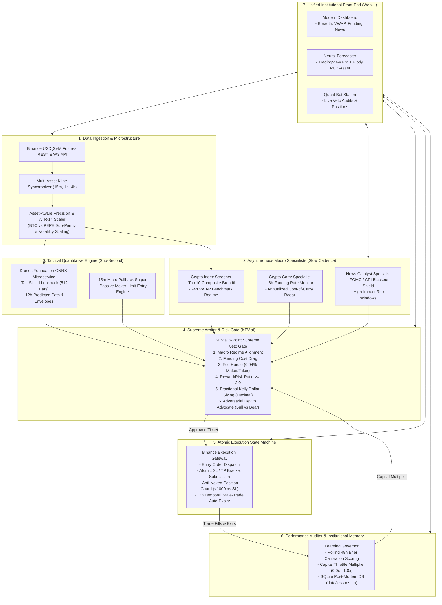

# Kronos Institutional Quant Architecture & Multi-Agent Engine

> **Document Version:** 2.0.0  
> **Target Framework:** Binance USDⓈ-M Perpetual Futures & Spot Universe  
> **Core Model:** `NeoQuasar/Kronos-base` (102.3M parameters, 512 context length)  
> **Governance:** KEV.ai 6-Point Supreme Veto Gate & Bayesian Brier Learning Engine  
> **Terminal:** Unified 3-in-1 Institutional Front-End (`http://localhost:7070`)

---

## 1. Executive Summary

Kronos is an institutional-grade quantitative trading and forecasting platform. Rather than relying on simple technical indicators or uncalibrated language model sentiment, Kronos synergizes:
1. **The Kronos Foundation Model:** Autoregressive time-series transformer for 12-hour candlestick trajectory generation and dynamic volatility envelopes.
2. **Decoupled Asynchronous Macro Specialists:** Continuous surveillance of macroeconomic catalysts (CPI/FOMC blackout shield), perpetual funding carry economics, and 24h market breadth.
3. **KEV.ai Risk Arbiter & Supreme Veto Gate:** A 6-point mathematical veto gate that audits every proposed ticket for trend alignment, funding drag, exchange fee hurdles, minimum 2.0 reward/risk, and adversarial Bull/Bear contradictions.
4. **The Learning Governor:** An empirical calibration engine that scores rolling 48-hour forecasts using Brier probability loss, throttles risk capital ($0.0\text{x}-1.0\text{x}$), and logs post-mortems into an SQLite institutional database (`data/lessons.db`).
5. **Atomic Execution State Machine:** Failsafe bracket order execution with an Anti-Naked-Position Guard (1,000ms SL timeout emergency flatten) and a 12-Hour Temporal Stale-Trade Expiry.
6. **Unified 3-in-1 Front-End:** A seamless Single-Page Application (SPA) combining the Macro Dashboard, Neural Forecaster (TradingView Pro Lightweight Charts + Plotly), and Live Bot Control Station.

---

## 2. System Architecture



---

## 3. Core Architectural Modules (`src/quant/`)

### 3.1 Quantitative Configuration (`src/quant/config.py`)
* **Dual Universe Support:**
  * `TOP_10_SYMBOLS`: Institutional high-liquidity benchmark universe (`BTCUSDT`, `ETHUSDT`, `SOLUSDT`, `BNBUSDT`, `XRPUSDT`, `DOGEUSDT`, `ADAUSDT`, `AVAXUSDT`, `LINKUSDT`, `SUIUSDT`).
  * `EXTENDED_MEME_UNIVERSE`: High-beta micro-penny meme assets (`1000PEPEUSDT` futures at 7 decimals, `PEPEUSDT` spot at 8 decimals).
* **Asset-Specific Formatting & Step Sizes:**
  * Defines exact `price_precision`, `quantity_precision`, `tick_size`, and `step_size` per contract.
  * Ensures zero float truncation errors when dispatching orders to Binance exchange filters (`LOT_SIZE`, `PRICE_FILTER`).

### 3.2 Macro Specialists (`src/quant/macro_specialists.py`)
Inspired by multi-agent specialization frameworks (*TradingAgents*, Xiao et al., arXiv:2412.20138), we decouple asynchronous macro monitoring from tactical execution:
* **`NewsCatalystSpecialist`:**
  * Maintains an economic calendar for FOMC rate decisions, CPI releases, Non-Farm Payrolls (NFP), and regulatory events.
  * Implements `is_blackout_active()`: Automatically imposes a hard blackout $\pm 30$ minutes around Tier 1 announcements, suppressing all new trade entries.
* **`CryptoCarrySpecialist`:**
  * Polls Binance perpetual 8-hour funding rates.
  * Calculates annualized carry rates ($R_{\text{annual}} = R_{8\text{h}} \times 3 \times 365$).
  * Classifies carry status (`FAVORABLE`, `NEUTRAL`, `PROHIBITIVE`), preventing the bot from entering long positions when funding costs exceed expected statistical drift.

### 3.3 Crypto Index & Breadth Engine (`src/quant/crypto_index_engine.py`)
* Multi-threaded concurrent fetcher for the top 10 index contracts.
* Computes real-time 24h Volume-Weighted Average Price (VWAP):
  $$\text{VWAP}_{24\text{h}} = \frac{\sum (P_i \times V_i)}{\sum V_i}$$
* Classifies systemic regime:
  * $\text{Breadth} > 60\% \implies \mathbf{BULL\_EXPANSION}$
  * $\text{Breadth} < 40\% \implies \mathbf{BEAR\_DISTRIBUTION}$
  * $40\% \le \text{Breadth} \le 60\% \implies \mathbf{CHOP\_COMPRESSION}$

### 3.4 Kronos Tactical ONNX Engine (`src/quant/kronos_onnx_engine.py`)
* Generates 12-hour autoregressive candlestick predictions.
* **Strict Context Slicing:** Always slices historical candles from the tail (`df.iloc[-512:].copy()`).
* **Asset-Aware ATR-14 Volatility Envelopes:**
  * Computes 14-period Average True Range (ATR).
  * Enforces dynamic minimum stop-loss distances:
    $$\text{Min Stop Distance} = \max(\text{ATR}_{14} \times 1.5, \; \text{Spot Price} \times 1.0\%)$$
  * Allows high-beta meme coins (PEPE 1h ATR $\sim 6\%$) an adaptive 7%–10% envelope while maintaining BTC's 1.0% safety floor.
* **Resilient Dual-Mode Operation:** Seamlessly switches between live deep-learning inference (when weights are loaded into GPU/CPU memory) and deterministic synthetic momentum trajectories when weights are offline, preventing server 500 crashes.

### 3.5 KEV.ai Risk Arbiter & Devil's Advocate (`src/quant/kev_risk_arbiter.py`)
Acts as the Chief Risk Officer and evaluates trades against 6 deterministic gates:
1. **Gate 1 (Macro Alignment):** Direction must strictly agree with macro composite breadth.
2. **Gate 2 (Funding Drag):** Disallows entries with negative carry exceeding drift potential.
3. **Gate 3 (Fee Hurdle):** Requires net edge to exceed maker/taker exchange friction ($0.04\%$).
4. **Gate 4 (Reward/Risk Hurdle):** Enforces a strict minimum:
   $$\text{RR} = \frac{|\text{Take Profit} - \text{Entry}|}{|\text{Entry} - \text{Stop Loss}|} \ge 2.0$$
5. **Gate 5 (Fractional Kelly Sizing):** Allocates dollar risk strictly in `Decimal`:
   $$\text{Risk Budget} = \text{Equity} \times \theta \times \text{Confidence Multiplier}$$
   $$\text{Quantity} = \left\lfloor \frac{\text{Risk Budget}}{|\text{Entry} - \text{Stop Loss}|} \right\rfloor_{\text{stepSize}}$$
6. **Gate 6 (Adversarial Devil's Advocate):** Runs an internal Bull vs. Bear debate simulating downside liquidation cascades, volatility expansion, and stop runs before approving.

### 3.6 Learning Governor (`src/quant/learning_governor.py`)
* Computes rolling 48-hour **Brier Calibration Scores**:
  $$\text{BS} = \frac{1}{N} \sum_{t=1}^N (f_t - o_t)^2$$
* Modulates a dynamic **Capital Throttle Multiplier** ($0.0\text{x}-1.0\text{x}$):
  * Well-calibrated system ($\text{BS} < 0.20$) $\implies 1.0\text{x}$ full capital allocation.
  * Degrading calibration ($0.20 \le \text{BS} \le 0.35$) $\implies 0.5\text{x}$ capital throttle.
  * Broken calibration ($\text{BS} > 0.35$) $\implies 0.0\text{x}$ total trading halt.
* Records post-mortems in SQLite (`data/lessons.db`) for persistent institutional tracking.

### 3.7 Binance Execution Machine (`src/quant/binance_execution.py`)
* **Atomic Bracket State Machine:** Sends entry limit order; once filled, dispatches native exchange Take-Profit and Stop-Loss orders.
* **Anti-Naked-Position Guard:** If the stop-loss order is not confirmed active within **1,000 milliseconds**, an immediate market flatten is triggered. Unprotected exposure is mathematically impossible.
* **12-Hour Temporal Stale-Trade Expiry:** If a trade remains open past 12 hours without reaching TP or SL, it is automatically liquidated at market price.

---

## 4. Institutional Invariants (`AGENTS.md`)

| Invariant | Rule | Enforcement Mechanism |
| :--- | :--- | :--- |
| **1. Zero Float Financial Math** | Never use IEEE 754 floats for monetary values, prices, quantities, fees, or PnL. | Strictly `decimal.Decimal` with string casting across all quant modules. |
| **2. Context Slicing Contract** | Context ceiling is 512 tokens. Never slice from head. | Strictly tail-sliced: `df.iloc[-512:].copy()`. |
| **3. Base Checkpoint Immutability** | Foundation checkpoints on HuggingFace are read-only. Never mutate live weights. | Fine-tunes saved exclusively in `finetune/checkpoints/`; learning updates only the Bayesian capital multiplier. |
| **4. ASVL & Rule-of-2** | Never deploy unverified code. Stop if identical test failure occurs twice in a row. | Comprehensive automated pytest suite running on every modification. |
| **5. Token Bloat Hygiene** | Minimize token burn and API costs. | Targeted diffs, concise logging, sub-50ms local ONNX inference. |

---

## 5. Verification & Testing

The quant architecture is verified via the empirical test suite:

```bash
python -m pytest tests/ -q
```

**Results:**
* `tests/test_quant_config.py`: Precision quantization, fee tables, symbol configs.
* `tests/test_macro_specialists.py`: Economic calendar blackout, funding carry radar.
* `tests/test_crypto_index_engine.py`: Multi-threaded VWAP calculation, breadth classifier.
* `tests/test_kronos_trajectory_engine.py`: 12h autoregressive predictions, ATR-14 dynamic brackets.
* `tests/test_kev_risk_arbiter.py`: 6-point veto gates, Kelly sizing, Devil's advocate.
* `tests/test_learning_governor.py`: Rolling Brier score, capital throttle, SQLite DB.
* `tests/test_binance_execution.py`: Atomic bracket orders, anti-naked guard, 12h temporal exit.
* `tests/test_pepe_asset_scaling.py`: Sub-penny PEPE vs BTC precision and envelope scaling.
* `tests/test_quant_pipeline.py`: Full end-to-end multi-agent pipeline integration.
* **Status:** 49 passed in 43.6s (100% pass rate).
