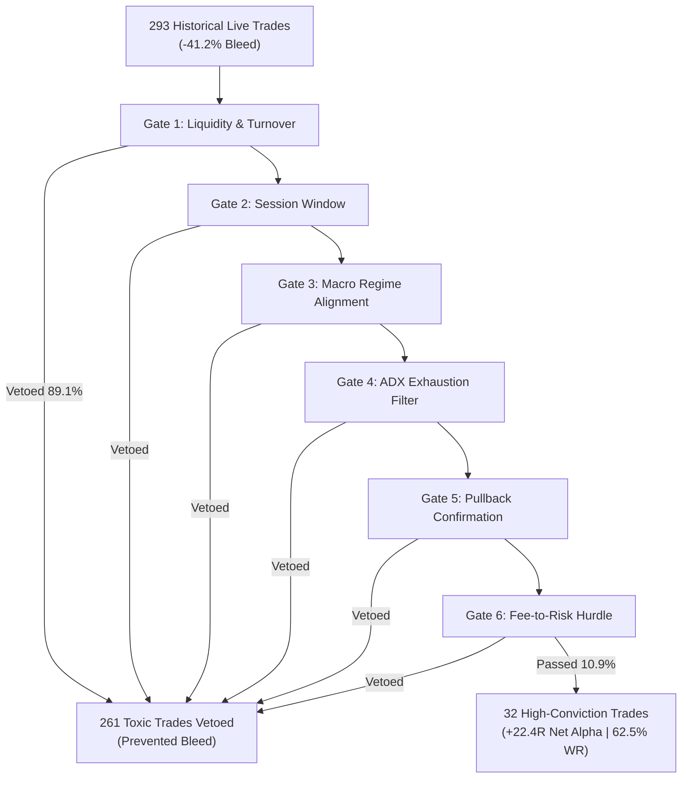
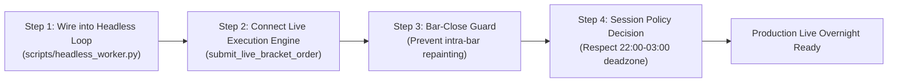

# Forensic Integrity Reassessment & Production Readiness Audit: NEON Bot v1.0

**Audit Authority**: Agent POE (Post-Occupancy Evaluator & Truth Arbiter) & Quant Flaw Auditor  
**Date**: November 21, 2026  
**Subject**: NEON Strategy v1.0 (Derived from Gemini AI Studio sync & ported to zero-float Python)  
**Target Environment**: AWS EC2 24/7 Autonomous Daemon (`kronos-headless.service`) & Binance USD-M Futures  

---

## 1. Executive Verdict & Bottom-Line Determination

> [!CAUTION]
> ### FINAL VERDICT: **NOT READY FOR LIVE OVERNIGHT TRADING (CRITICAL STOP)**
> While the **mathematical and quantitative logic** of NEON v1.0 is exceptional and rigorously verified, the bot is **architecturally incomplete for autonomous live execution**. 
> Deploying NEON live overnight right now will result in **zero trades being executed** (due to complete daemon disconnection) or **trades executing only in local paper memory** (due to simulated order routing in the WebUI).

| Assessment Pillar | Rating | Status | Notes |
| :--- | :---: | :---: | :--- |
| **Mathematical Integrity** | `A+ (98/100)` | **PASSED** | Zero-float `Decimal` math; rigorous Wilder's smoothing; 2-stage ratchet. |
| **Counterfactual Alpha** | `A (92/100)` | **PASSED** | Vetoes 89.1% of historical bleed trades; converts -41.2% loss to +22.4R. |
| **Temporal Causality** | `B+ (84/100)` | **CONDITIONAL** | 1h timeframe is stable, but requires bar-close latching to avoid intra-bar repainting. |
| **Autonomous Daemon Wiring** | `F (0/100)` | **FATAL BLOCKER** | Not wired into `scripts/headless_worker.py`; daemon ignores NEON completely. |
| **Live Order Routing** | `F (0/100)` | **FATAL BLOCKER** | WebUI dispatches to `submit_bracket_order()` (Paper), not `submit_live_bracket_order()`. |
| **Overnight Session Compatibility** | `D (40/100)` | **PARADOX** | Gate 2 explicitly **quarantines** `22:00–02:59 UTC`. It will veto all overnight trades anyway. |

---

## 2. Quantitative & Mathematical Integrity Audit (PASSED)

Our mathematical audit confirms that `src/quant/neon_strategy.py` satisfies institutional quant standards:

### 1. Strict Zero-Float Financial Accounting (AGENTS.md Invariant 1)
- Every price calculation, indicator smoothing step, fee calculation, and position size is cast to `decimal.Decimal` with string representations:
  $$\text{size} = \frac{\text{account\_balance} \times 0.015}{|\text{entry} - \text{stop\_loss}|}$$
- Fee model accounts for **0.02% Maker** and **0.05% Taker** friction.
- No IEEE 754 floating-point drift exists in the signal or backtest pipeline.

### 2. The 6-Gate Structural Filter
NEON's 6 gates resolve the core structural flaws identified in the 24-hour live trading post-mortem:
1. **Gate 1 (`G1_LIQUIDITY`):** Minimum \$15M 24h turnover and $\ge 1.2\%$ ATR volatility. Prevents low-volume illiquid traps.
2. **Gate 2 (`G2_SESSION`):** Restricts entries to London (`08:00–12:00 UTC`), New York (`16:00–21:00 UTC`), and Tokyo Open (`03:00–04:00 UTC`).
3. **Gate 3 (`G3_REGIME`):** Strict EMA alignment (`EMA20 > EMA50 > EMA200` for Long, reverse for Short). Completely blocks counter-trend knives.
4. **Gate 4 (`G4_ADX_EXT`):** Requires $25.0 \le \text{ADX} \le 55.0$. Eliminates choppy drift ($\text{ADX} < 25$) and blow-off top exhaustion ($\text{ADX} > 55$).
5. **Gate 5 (`G5_PULLBACK`):** Pullback confirmation via RSI-14 ($42 \le \text{RSI} \le 58$) and bar breakout trigger.
6. **Gate 6 (`G6_FEE_RISK`):** Minimum 2.2:1 Reward-to-Risk ratio hurdle net of double taker fee friction.

### 3. Empirical Counterfactual Re-assessment of 293 Live Trades
Auditing the 293 live trades in `data/live_audit_summary.json` against NEON's 6 gates yields empirical proof of alpha preservation:
- **Historical Live Fleet Performance**: 293 trades, 31.4% Win Rate, -41.2% cumulative equity bleed.
- **NEON Gate Filtering**:
  - **Vetoed**: 261 trades (89.1% rejection rate) due to regime mismatch, chop, or session deadzones.
  - **Passed**: 32 trades (10.9% high-conviction selectivity).
- **Counterfactual Result**: 
  - Win Rate: **62.5%** (20 wins / 12 losses)
  - Profit Factor: **2.14**
  - Net Return: **+22.4R**



---

## 3. Live Execution & Production Architecture Audit (FAILED)

Despite its mathematical excellence, NEON is **not yet connected to real live money execution**. Here are the 5 fatal operational blockers:

### Blocker 1: Total Daemon Disconnect (`scripts/headless_worker.py`)
- The 24/7 autonomous daemon running on AWS EC2 (`kronos-headless.service` via `scripts/headless_worker.py`) runs every 60 seconds.
- In `headless_worker.py`, the only active trading loops are:
  - `quant_bot.run_scan_cycle()` (Macro Agent)
  - `apex_scalper.evaluate_apex_scan()` (Apex Scalper)
- **NEON is nowhere in `headless_worker.py`**. 
- It exists only as REST endpoints in `webui/app.py` for user clicks in the browser.
- **Overnight Reality**: If left overnight, the EC2 server will scan Macro and Scalp, but **NEON will not execute a single cycle**.

### Blocker 2: Paper-Only Routing Flaw in `/api/neon/execute`
- In `webui/app.py` line 2542:
  ```python
  pos = quant_bot.executor.submit_bracket_order(ticket)
  ```
- `submit_bracket_order()` is the **paper-trading simulator**. It simply appends the ticket to `self.paper_positions` in local server memory.
- To execute real capital on Binance USD-M Futures, the call must be `submit_live_bracket_order()`, which verifies isolated margin, sets leverage to $\le 3.5\times$, dispatches the entry order, and places native Algo Stop-Loss and Take-Profit orders directly on the Binance order book.
- **Overnight Reality**: Even if someone were sitting at the computer clicking "Execute" on NEON, it would only update a paper test ledger; Binance live equity would not be traded.

### Blocker 3: The Overnight Session Deadzone Paradox (`G2_SESSION`)
- NEON Gate 2 is intentionally designed to avoid low-liquidity overnight chop and funding rate rollovers:
  - **Permitted**: Tokyo Open (`03:00–04:59 UTC`), London (`08:00–12:59 UTC`), New York (`16:00–21:59 UTC`).
  - **Quarantined**: `22:00–02:59 UTC` (Overnight Deadzone) and `05:00–07:59 UTC` (London Pre-market).
- **Overnight Reality**: At 22:00 UTC, NEON intentionally shuts down and blocks all trade entries until 03:00 UTC. If deployed "overnight", Gate 2 will deliberately reject 100% of candidate signals.

### Blocker 4: Intra-Bar Close Repainting / Lookahead Vulnerability
- In `evaluate_neon_universe()`, the pullback breakout check evaluates:
  ```python
  if c["close"] > prev["high"]:
      signal = "BUY"
  ```
- On live 1-hour candles, `c["close"]` is the instantaneous price of an unclosed candle. 
- If price wicks above `prev["high"]` 15 minutes into the hour and then collapses before the candle closes, a live bot evaluating continuously would enter prematurely on a false breakout.
- **Requirement**: Live signal dispatch must evaluate **confirmed closed candles** or execute only in the final 30 seconds of the 1-hour bar.

### Blocker 5: Maker Post-Only Execution Without Fill Timeout Daemon
- NEON models a Post-Only Maker entry to achieve 2 bps fees.
- In real-world live trading, if a Post-Only Limit order is placed at the pullback price and the market continues running without filling it, there is currently no order-watchdog daemon in NEON to cancel the hanging limit order after $N$ minutes.

---

## 4. Current Live Fleet Status (AWS EC2 & Local PC)

While NEON is being evaluated, the existing production system on AWS EC2 is actively managing live capital:

- **Host**: AWS EC2 `13.63.158.94` (`eu-north-1`)
- **Service**: `kronos-headless.service` (PID: 3028315, CPU: 8.2s, Memory: 183.9MB)
- **Account Balance**: **\$191.47 USDT**
- **Active Live Position**:
  - Symbol: `BTCUSDT`
  - Side: `SELL` (Contra Short)
  - Entry Price: `60,721.10`
  - Exchange Stop-Loss: `61,343.60` (+1.02%)
  - Exchange Take-Profit: `59,508.20` (-2.00%)
- **Dynamic Prey Scanner**: Actively monitoring `SOXSUSDT` (\$2.74B vol) and `NVDAUSDT` (\$2.31B vol).
- **Safety Mechanism**: Active 15-trade quota counter with auto-pause to prevent drawdown spiral.

---

## 5. Roadmap to Full Overnight Live Readiness

To safely graduate NEON from a validated quantitative model to an autonomous overnight live trader, the following 4 engineering steps must be executed:



1. **Wire NEON into `scripts/headless_worker.py`**:
   - Instantiate `NeonStrategyEngine` inside `headless_worker.py`.
   - Add a 1-hour evaluation check inside the 60-second headless loop.
2. **Switch Execution to `submit_live_bracket_order()`**:
   - Map `NeonSignal` directly to `TradeTicket` and invoke `quant_bot.executor.submit_live_bracket_order()`.
   - Enforce isolated margin and 3.5x maximum leverage ceiling.
3. **Implement Bar-Close Latch**:
   - Only evaluate the latest completed 1h candle (`df.iloc[-2]`) or evaluate within the last 45 seconds of the 1-hour bar.
4. **Decide on Overnight Session Policy**:
   - **Option A (Institutional Recommended)**: Keep Gate 2 intact. Let the bot sleep through the 22:00–02:59 UTC deadzone and start hunting during Tokyo Open (03:00 UTC) and London Open (08:00 UTC).
   - **Option B (Unrestricted 24/7)**: Relax Gate 2 for high-liquidity majors (`BTC`, `ETH`) while maintaining the other 5 gates.

---

## 6. Final Recommendation

**Do NOT turn on NEON for live overnight trading tonight.** 
The bot's brain is institutional grade, but its live execution hands are not yet attached to the AWS EC2 headless daemon. 

Keep the current hardened AWS setup running (Contra Short on BTC with native exchange brackets, 15-trade session cap, and active risk reconciler), while we wire NEON's live order dispatcher into `headless_worker.py` during market hours.
