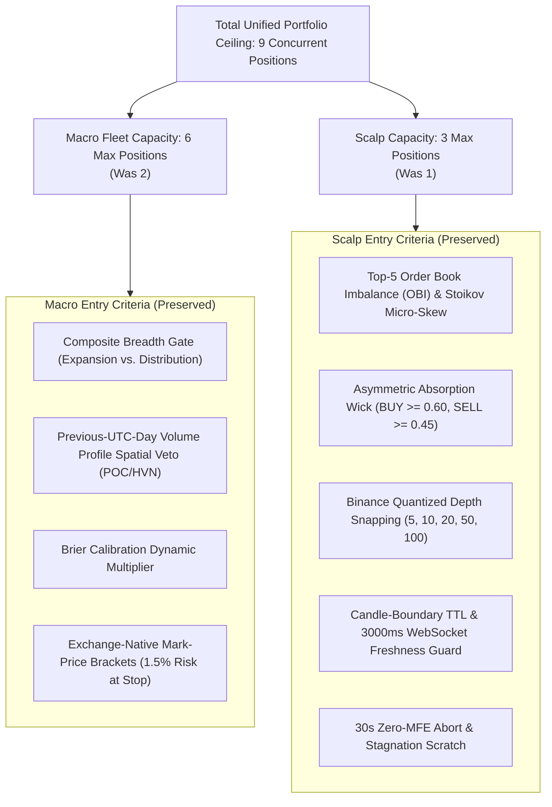
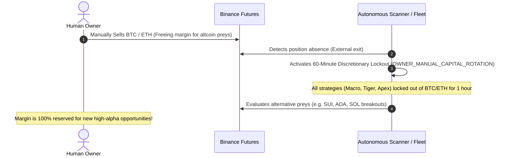

# Kronos Concurrency Expansion & Discretionary Owner Override Architecture

> **Institutional Quantitative Risk & Execution Specification**  
> **Status:** Production Deployed (Local PC & AWS EC2 Stockholm `13.63.158.94`)  
> **Associated Lessons:** [Lesson #48, #49, #50](file:///F:/012D_TRADE/Kronos/data/lessons.db)  
> **Authoritative Services:** `kronos-headless.service` & `tiger_worker.py --live`

---

## 1. Executive Summary

As the Kronos multi-agent trading system matured through live execution and telemetry auditing on Binance USDⓈ-M Futures, two major operational upgrades were mandated:

1. **Portfolio Concurrency Expansion (Opening the Doors):**  
   Expanding maximum concurrent exposure from 3 positions (2 Macro + 1 Scalp) to **9 positions (6 Macro + 3 Scalp)**, allowing the fleet to seize broader market breadth across multiple non-correlated perpetual assets without altering mathematical risk criteria.
2. **Discretionary Owner Manual Sell Sovereign Override (Capital Rotation):**  
   Eliminating **algorithmic amnesia** by enforcing a mandatory **60-minute (1-hour) post-exit quarantine** whenever the owner manually closes or sells an active position, ensuring 100% of liberated margin is preserved for new opportunities rather than immediately re-bought by the bot.

---

## 2. Portfolio Concurrency Allocation: 6 Macro + 3 Scalp



### Concurrency Matrix

| Strategy Tier | Previous Limit | **New Expanded Limit** | Allocation Purpose | Engine Responsible |
| :--- | :--- | :--- | :--- | :--- |
| **Macro Swings** | 2 Positions | **6 Positions** | Medium-horizon directional capture on majors/mid-caps | `QuantBotOrchestrator` / `headless_worker.py` |
| **Lightning Scalps** | 1 Position | **3 Positions** | High-velocity microstructural absorption & orderflow squeezes | `TigerExecutionEngine` & `ApexLightningScalper` |
| **Total Portfolio** | 3 Positions | **9 Positions** | Comprehensive cross-asset coverage with unified capital bounds | `RiskEngine` / `RiskLedger` atomic slot reservations |

---

## 3. Discretionary Owner Manual Sell Override (1-Hour Lockout)

### The Problem: Algorithmic Amnesia
In automated systems, when an owner manually closes an asset (e.g. market-selling BTC or ETH on Binance or WebUI) to free up margin for higher-velocity altcoin preys, standard bots see the freed USDT and immediately re-evaluate the asset. If the technical indicators still meet criteria, the bot buys it back within 5 to 15 minutes, destroying the owner's strategic rotation.



### The Invariant Implementation
1. **Dynamic Detection:** Both `headless_worker.py` and `webui/app.py` continuously track active Binance positions. If a symbol previously held disappears without a bot-generated TP/SL trigger, it is recognized as `MANUAL_OR_EXCHANGE_EXIT`.
2. **Extended 3600-Second Quarantine:**
   ```python
   apex_scalper.register_symbol_cooldown(
       symbol=exited_sym,
       current_time_utc=now_utc,
       duration_seconds=3600,
       reason="OWNER_MANUAL_CAPITAL_ROTATION"
   )
   quant_bot.register_symbol_cooldown(
       symbol=exited_sym,
       current_time_utc=now_utc,
       duration_seconds=3600,
       reason="OWNER_MANUAL_CAPITAL_ROTATION"
   )
   ```
3. **Cross-Fleet Quarantine Propagation:** The lockout is written to `tiger_state.json` and `tiger_quarantines` in `tiger_trades.db`, locking the symbol out of Stalking Tiger, Apex Scalper, and Macro Swing simultaneously.
4. **"Hold the Line" Principle:** Even if the market displays strong upward momentum during that hour, the bot honors the owner's strategic exit.

---

## 4. Joined Market Data Fetching & Binance Depth Quantization

To prevent API friction during multi-asset candidate screening:

1. **Binance Depth Snapping (`_normalize_binance_depth_limit`):**
   Binance USD(S)-M Futures REST API `/fapi/v1/depth` strictly rejects unquantized limits (e.g. `limit=15`) with `HTTP 400: -4021`. All depth queries are snapped to the valid set `[5, 10, 20, 50, 100, 500, 1000]`.
2. **Candle-Boundary TTL Cache:**
   Using epoch modulo arithmetic `int(now // interval_sec) > int(cached_ts // interval_sec)`, crossing a candle boundary immediately purges cached klines, guaranteeing that candle `[-2]` is confirmed and closed.
3. **3000ms WebSocket Staleness Guard:**
   If the multiplex order flow stream stalls, snapshots older than 3000ms are dropped, falling back to cached REST data.

---

## 5. Continuous 24/7 Anti-Bloat Engine

Running 24/7 on AWS EC2 Free Tier (`t2.micro` / `t3.micro`, 1GB RAM) requires strict memory hygiene:
- **Dynamic RSS Ceilings:** Normal $<180\text{MB}$, Warning $>180\text{MB}$, Critical $>240\text{MB}$ (PC ceiling: 750MB).
- **Log Truncation:** Truncates `tiger_live.log` when exceeding 4MB, retaining the most recent 2,500 lines.
- **Orphaned File Purge:** Removes `_temp_*`, `.tmp`, and stale CSVs while strictly preserving `IMMUTABLE_DATA_WHITELIST` (`lessons.db`, `tiger_trades.db`, `tiger_state.json`, `scalp_orders.json`).
- **SQLite Compaction:** Runs `PRAGMA wal_checkpoint(TRUNCATE)` and `VACUUM` on active databases.
- **WebUI Topbar Telemetry:** Real-time indicator `🧹 BLOAT: NORMAL (142MB | AWS)` with one-click manual deep cleanse.

---

## 6. Verification & Operational Status

- **AWS Headless Authority (`13.63.158.94`):**
  - `kronos-headless.service`: Running active (PID 2935947, 142MB RAM).
  - `scripts/tiger_worker.py --live --quota 5`: Running active (PID 2936101, 89MB RAM).
  - Quota reporting: `max_concurrent_positions: 9`, `macro: 6`, `scalp: 3`.
- **Local WebUI (`http://127.0.0.1:7070`):**
  - Real-time telemetry relay over encrypted SSH tunnel (Port 7072).
  - Topbar indicator: `🌊 CALM WATERS (6M / 3S)`.
- **Regression Tests:** 37/37 passing across all invariant and smoke suites.
