# Kronos 24/7 Autonomous Paper Trading & Realistic Execution Manual

> **Document Version:** 1.0.0  
> **Target Framework:** Binance USDⓈ-M Perpetual Futures & Spot Multi-Asset Universe  
> **Baseline Account Profile:** Small-Account Micro-Trading Engine ($200.00 USDT Initial Equity)  
> **Execution Engine:** `BinanceAtomicExecutor` with Realistic Institutional Friction & 24/7 Autopilot  
> **Terminal Web UI:** `http://localhost:7070`

---

## 1. Executive Summary & Purpose

In retail algorithmic trading, standard paper trading simulations are notorious for creating **false alpha and misleading win-rate reports**. Typical naive simulators assume:
1. Instant fills at mid-market prices with zero execution slippage.
2. Complete absence of exchange trading fees (maker/taker friction).
3. Zero perpetual funding rate or cost-of-carry drag.
4. Fake breakeven exits when trades linger past temporal limits.
5. Optimistic fill probability on wick touches without order book queue depth.

Under such conditions, an algorithm that is unprofitable in live trading may falsely report a 70%+ win rate and compounding equity. When switched to real capital, exchange fee drag (typically 0.08% to 0.10% round-trip) immediately destroys the unmodeled edge.

The **Kronos Realistic Paper Trading Engine** was formulated to provide **institutional-grade fidelity**. It bridges the gap between simulation and real-world Binance USDⓈ-M Perpetual Futures execution, ensuring that every dollar of profit or loss, every basis point of slippage, and every maker/taker fee accurately reflects live trading dynamics.

---

## 2. 24/7 Autonomous Autopilot Architecture

The Kronos trading daemon runs continuously in the background without requiring user intervention.

```mermaid
flowchart TD
    subgraph DaemonLoop ["24/7 Autopilot Daemon Thread (Interval: 60s)"]
        START["Timer Tick (Every 60s)"] --> CHECK_LOCK["Check bot_autopilot_enabled Lock"]
        CHECK_LOCK --> PRICE_SYNC["1. Synchronize Live Binance K-Lines & Mark Prices"]
        PRICE_SYNC --> TRIGGER_CHECK["2. Audit Active Positions vs Take-Profit & Stop-Loss"]
        TRIGGER_CHECK --> TEMPORAL_SWEEP["3. Sweep 12-Hour Stale Positions (Liquidate at Market)"]
        TEMPORAL_SWEEP --> LEARNING_LOG["4. Log Closed Trade Outcomes to data/lessons.db"]
        LEARNING_LOG --> MACRO_EVAL["5. Evaluate Top-10 Universe & Breadth Regime"]
        MACRO_EVAL --> KEV_VETO["6. KEV.ai 6-Point Supreme Veto Gate Audit"]
        KEV_VETO --> DISPATCH["7. Dispatch Approved Micro Tickets (Max 3 Concurrent)"]
        DISPATCH --> PERSIST["8. Atomic State Save to data/paper_trading_state.json"]
        PERSIST --> GEMINI_CHECK{"Every 5 Trades or 2 Hours?"}
        GEMINI_CHECK -- Yes --> GEMINI_CIO["9. Asynchronous Gemini Free Tier Sweetspot Advisory"]
        GEMINI_CHECK -- No --> SLEEP["Sleep for bot_autopilot_interval (60s)"]
        GEMINI_CIO --> SLEEP
        SLEEP --> START
    end
```



### 2.1 State Persistence & Crash-Resilient Memory
The engine enforces complete memory across restarts, server updates, and system reboots:
1. **Paper Trading State (`data/paper_trading_state.json`):**
   - Active open bracket positions (Entry price, SL, TP, quantities, fill timestamps, entry fee, slippage).
   - Realized trade ledger (Last 200 closed trades with gross PnL, fee drag, slippage, and net PnL).
   - Cumulative starting equity and current net equity.
2. **Bot Operational Memory (`data/bot_settings.json`):**
   - Autopilot status (`enabled: true/false`).
   - Autopilot scanning interval (Default: `60 seconds`).
   - Gemini Sweetspot parameters (`sweetspot_rr_ratio`, `sweetspot_fee_hurdle_pct`, `sweetspot_risk_budget_pct`).
   - Auto-Apply preference flag (`gemini_auto_apply: true/false`).
3. **Institutional Lessons Database (`data/lessons.db`):**
   - SQLite persistent database storing Bayesian Brier calibration scores, forecasted probabilities vs. realized outcomes, and failure post-mortems for online model adaptation.

---

## 3. Mathematical Formulation of Realistic Execution Friction

Every trade executed by `BinanceAtomicExecutor` adheres strictly to **AGENTS.md Invariant 1 (Zero Float Financial Math)** using `decimal.Decimal`.

### 3.1 Order Execution & Slippage Modeling

For a candidate trade on symbol $S$ with side $\in \{\text{BUY}, \text{SELL}\}$, quantity $Q$, and theoretical signal price $P_0$:

1. **Market Entry Spread & Slippage:**
   Market entry orders aggressively cross the exchange bid-ask spread:
   $$s = \text{config.est\_slippage\_rate} \quad (\text{BTC/ETH: } 0.03\%, \text{ Mid/Alts: } 0.05\% - 0.08\%)$$
   $$P_{\text{entry}} = \begin{cases} P_0 \times (1 + s) & \text{for BUY / LONG} \\ P_0 \times (1 - s) & \text{for SELL / SHORT} \end{cases}$$
   Quantized to symbol tick precision using `ROUND_HALF_UP`.

2. **Entry Taker Fee:**
   $$\text{Notional}_{\text{entry}} = Q \times P_{\text{entry}}$$
   $$\text{Fee}_{\text{entry}} = \text{Notional}_{\text{entry}} \times \text{taker\_fee\_rate} \quad (\text{VIP0: } 0.05\% / 0.0005)$$

3. **Take-Profit (Passive Resting Limit Order):**
   Take-Profit orders are placed as resting limit orders in the Binance order book:
   $$P_{\text{exit\_tp}} = P_{\text{TP}} \quad (\text{Zero slippage on limit fills})$$
   $$\text{Fee}_{\text{exit\_tp}} = (Q \times P_{\text{exit\_tp}}) \times \text{maker\_fee\_rate} \quad (\text{VIP0: } 0.02\% / 0.0002)$$

4. **Stop-Loss (Aggressive Market Liquidation):**
   Stop-Loss orders are `STOP_MARKET` orders. In rapid liquidation cascades or volatility spikes, stop-loss fills suffer adverse slippage:
   $$s_{\text{adverse}} = s \times 1.5$$
   $$P_{\text{exit\_sl}} = \begin{cases} P_{\text{SL}} \times (1 - s_{\text{adverse}}) & \text{for LONG (liquidating into falling bids)} \\ P_{\text{SL}} \times (1 + s_{\text{adverse}}) & \text{for SHORT (buying back from spiking asks)} \end{cases}$$
   $$\text{Fee}_{\text{exit\_sl}} = (Q \times P_{\text{exit\_sl}}) \times \text{taker\_fee\_rate} \quad (\text{VIP0: } 0.05\% / 0.0005)$$

5. **12-Hour Temporal Stale-Trade Market Expiry:**
   If an open trade reaches 12 hours without triggering TP or SL:
   - Fetches **live current market price** $P_{\text{market}}$ from real-time k-line data.
   - Executes market liquidation with taker fee ($0.05\%$) and adverse slippage.
   - Liquidates at true current market price rather than assuming an unrealistic $0 break-even exit.

6. **8-Hour Perpetual Funding Rate Drag:**
   Perpetual futures settle funding every 8 hours (00:00, 08:00, 16:00 UTC):
   $$\text{Funding Intervals Cross} = \left\lfloor \frac{\text{Duration (minutes)}}{480} \right\rfloor$$
   $$\text{Funding Drag} = \text{Notional}_{\text{entry}} \times R_{\text{8h}} \times \text{Funding Intervals Cross}$$

---

### 3.2 Dual-Layer PnL Accounting: Gross vs. Net Realized

Every completed trade produces a transparent dual-layer accounting record:

$$\text{Gross PnL} = \begin{cases} (P_{\text{exit}} - P_{\text{entry}}) \times Q & \text{for LONG} \\ (P_{\text{entry}} - P_{\text{exit}}) \times Q & \text{for SHORT} \end{cases}$$

$$\text{Total Friction} = \text{Fee}_{\text{entry}} + \text{Fee}_{\text{exit}} + \text{Funding Drag}$$

$$\text{Net Realized PnL} = \text{Gross PnL} - \text{Total Friction}$$

$$\text{Net Return \%} = \frac{\text{Net Realized PnL}}{\text{Notional}_{\text{entry}}} \times 100\%$$

### 3.3 The True Win Condition: Elimination of False Wins

In standard simulations, a trade that moves in your direction by $+0.04\%$ is recorded as a "WIN". In live Binance trading, a round-trip taker trade costs $\sim 0.10\%$ in fees, turning that trade into an immediate net loss.

Kronos strictly enforces the **Net Cash Rule**:
$$\text{Result} = \begin{cases} \mathbf{WIN} & \text{if Net Realized PnL} > \$0.00 \\ \mathbf{LOSS} & \text{if Net Realized PnL} < \$0.00 \\ \mathbf{EVEN} & \text{if Net Realized PnL} = \$0.00 \end{cases}$$

> Any trade whose gross profit is smaller than the exchange fee drag is **strictly classified as a LOSS**.

---

## 4. Test Isolation Architecture (Zero Ledger Contamination)

Automated tests (`pytest`) frequently generate synthetic order tickets with massive sizes (e.g. 4.0 ETH = $10,000 notional) to test boundary conditions.

To prevent test fixtures from contaminating the live paper trading ledger:
```python
is_test_env = "PYTEST_CURRENT_TEST" in os.environ or "pytest" in sys.modules
if state_file is None:
    if is_test_env:
        self.state_file = None  # Operates strictly in memory; zero disk write
    else:
        self.state_file = os.path.join(workspace_root, "data", "paper_trading_state.json")
```

Whenever tests are run (`python -m pytest tests/ -q`), all state serialization to disk is suppressed unless a temporary test directory (`tmp_path`) is explicitly provided. **The production paper ledger remains 100% clean and isolated.**

---

## 5. Gemini Free Tier Strategic Copilot (CIO Feedback Loop)

Operating on a slow cadence (every 5 closed trades or every 2 hours), Google Gemini Free Tier (`gemini-3.8-flash`) analyzes the synthesized output of:
1. **The Learning Governor:** Rolling Brier loss and SQLite failure lessons.
2. **The Kronos ONNX Engine:** Macro composite breadth and price trajectory corridors.
3. **KEV.ai Risk Arbiter:** Veto audit statistics and friction economics.

### 5.1 The Sweetspot Matrix & Clamping Guardrails

Gemini prescribes dynamic hurdle parameters, which are strictly passed through deterministic Python clamping:

| Parameter | Permitted Clamping Range | Purpose |
| :--- | :--- | :--- |
| **`sweetspot_rr_ratio`** | $[1.40\text{x}, 2.20\text{x}]$ (Default: $1.60\text{x}$) | Adjusts minimum reward/risk required before KEV.ai approves ticket dispatch. |
| **`sweetspot_fee_hurdle_pct`** | $[0.35\%, 0.75\%]$ (Default: $0.50\%$) | Minimum expected price drift above maker/taker friction. |
| **`sweetspot_risk_budget_pct`**| $[0.80\%, 1.50\%] \le \$3.00$ | Dollar risk budget per trade for small-account preservation ($200.00 base). |
| **`sweetspot_fast_ema` / `slow_ema`** | $[10, 25]$ / $[45, 80]$ | Dynamic momentum lookback windows. |

If **`Auto-Apply Sweetspot`** is enabled, KEV.ai adopts new parameters immediately without human intervention, continuously keeping the bot positioned in its optimal mathematical sweetspot.

---

## 6. Small-Account Micro-Trading Risk Rules ($200 USDT Profile)

To protect small accounts and simulate realistic retail-to-institutional transitions:
1. **Starting Equity:** Strictly initialized to **$200.00 USDT**.
2. **Maximum Portfolio Leverage:** Strictly capped at **5x** (Maximum cumulative portfolio notional $\le \$1,000.00$).
3. **Maximum Concurrent Positions:** Strictly capped at **3 concurrent positions** (Maximum $\sim \$300$ notional per asset).
4. **Dollar Risk Budget:** Strictly capped at **$\le \$3.00$ per trade** ($1.5\%$ of $\$200$).
5. **Anti-Naked-Position Guard:** If exchange Stop-Loss confirmation is not received within **1,000ms**, an emergency market flatten is executed instantly.

---

## 7. Operator Commands & REST API Reference

### 7.1 Starting the 24/7 Autopilot Service

To run the Kronos platform as a persistent background service on Windows:
```powershell
# Set UTF-8 encoding
$env:PYTHONIOENCODING="utf-8"

# Start Kronos Web UI & Autopilot Daemon
python -X utf8 webui/app.py
```
Access the interactive terminal at: `http://localhost:7070`

### 7.2 Key REST API Control Endpoints

| Endpoint | Method | Payload / Parameters | Description |
| :--- | :--- | :--- | :--- |
| `/api/bot/status` | `GET` | None | Returns bot state, equity, active positions, and autopilot health. |
| `/api/bot/autopilot/toggle` | `POST` | `{"enabled": true/false}` | Toggles the 24/7 autonomous scanning loop. |
| `/api/bot/scan` | `POST` | `{"account_equity": 200.0}` | Triggers an immediate full universe market scan. |
| `/api/bot/close-position` | `POST` | `{"position_id": "..."}` | Manually flattens an active bracket position at current price. |
| `/api/bot/paper-report` | `GET` | None | Returns complete audit ledger, gross/net PnL, fee drag, and win/loss count. |
| `/api/bot/paper-reset` | `POST` | `{"equity": 200.0}` | Resets paper equity back to $200.00 USDT and archives old trades. |
| `/api/gemini/assessment` | `GET` | None | Returns latest Gemini CIO assessment and active sweetspot matrix. |
| `/api/gemini/assess` | `POST` | None | Triggers an immediate on-demand strategic reasoning pass via Gemini. |
| `/api/gemini/toggle-auto-apply`| `POST` | `{"auto_apply": true/false}`| Toggles automatic sweetspot adoption upon assessment completion. |

### 7.3 Automated Verification Gate
```bash
# Fast smoke check (<2s)
python -m pytest tests/test_smoke.py -q

# Full institutional verification suite (58 tests)
python -m pytest tests/ -q
```
