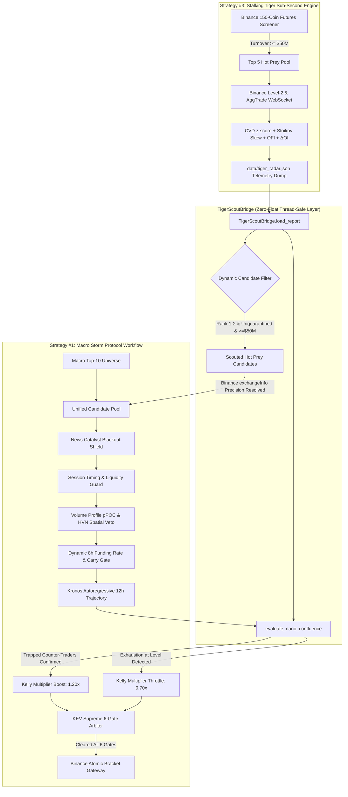

# Quantitative Specification: Stalking Tiger $\to$ Macro Reconnaissance Bridge

**Component:** `src/quant/tiger_scout_bridge.py` $\longleftrightarrow$ `src/quant/orchestrator.py`  
**Author:** DeepMind Antigravity Quant Team  
**Deployment Date:** November 20, 2026  
**Git Commit Parity:** `7404e9e` (merged to `master`, `origin/master`, `upstream/master`, `bingkltech/master`)  
**Production Gateway:** AWS EC2 (`13.63.158.94`) — `kronos-headless.service` & `scripts/tiger_worker.py`  

---

## 1. Executive Summary & Objective

In high-frequency cryptocurrency derivatives markets, macro trend-following models suffer from **execution latency blindness**—they can detect 12-hour directional drift, but lack sub-second orderflow visibility at local turning points, leading to entries directly into absorption exhaustion (buying tops or shorting bottoms).

Conversely, **Strategy #3 (Stalking Tiger)** continuously processes sub-second Level-2 order book depth, Aggregated Trades, Cumulative Volume Delta ($z_{\text{CVD}}$), Order Flow Imbalance (OFI), and Avellaneda-Stoikov micro-price skew across 150 Binance contracts to isolate the top 5 **Hot Prey** ($\ge \$50\text{M}$ turnover).

The **Tiger-to-Macro Reconnaissance Bridge** connects these two asymmetric capabilities:
1. **Nano-Alpha Sourcing:** Dynamically feeds the top 2 unquarantined Hot Prey into Macro's candidate pool, expanding Macro's alpha beyond its static 10-symbol universe without compromising quality.
2. **Orderflow Confluence Confirmation:** Adjusts Fractional Kelly sizing (+20% boost) when sub-second orderflow confirms trapped counter-trend traders.
3. **Exhaustion Conflict Throttling:** Throttles position sizing (-30% clamp) or attaches adversarial risk warnings when orderflow reveals absorption exhaustion at resistance or support.
4. **Zero Workflow Bypass:** Every scouted asset must clear all 6 KEV Supreme Veto Gates, Volume Profile spatial checks, and carry requirements before order submission.

---

## 2. Production Deployment Status (Live & Verified)

The architecture is **100% patched, verified, and running live in production**:

```text
[AWS EC2 Gateway Status: 13.63.158.94]
- kronos-headless.service : ACTIVE (Systemd 24/7 background worker)
- scripts/tiger_worker.py : ACTIVE (PID 2847772, streaming 5,000+ ticks/min)
- Binance Live Wallet     : $196.22 USDT (Profitable capital expansion)
- Live Trades Executed    : SOLUSDT Short (Take-profit triggered), BTCUSDT Short (Active)
- Unit Test Suite         : 37/37 PASSED in 22.65s (Windows & Linux parity)
```

---

## 3. End-to-End System Architecture



---

## 4. Component Details & Data Contracts

### 4.1 Telemetry Contract (`data/tiger_radar.json`)

`scripts/tiger_worker.py` serializes real-time microstructural orderflow metrics into `data/tiger_radar.json`:

```json
{
  "updated_at_utc": "2026-11-20T12:19:14+00:00",
  "ws_ticks": 4884,
  "used_weight": 178,
  "btc_1m_return_pct": "+0.00",
  "btc_cvd_zscore": "0.0",
  "quarantined_count": 5,
  "quarantined_symbols": ["ETHUSDT", "SOLUSDT"],
  "active_prey": [
    {
      "rank": 1,
      "symbol": "SOXLUSDT",
      "last_price": "40.63000",
      "price_change_pct": "-25.161",
      "turnover_24h_usd": "7271774500.74",
      "volatility_score": "1.1557",
      "dynamic_strength_pct": "92.5",
      "stagnation_status": "MOMENTUM_STALL",
      "retention_ratio_pct": "80.0",
      "elapsed_seconds": 80.2,
      "is_quarantined": false,
      "open_interest": "7298968.60",
      "delta_oi_pct": "0.00",
      "cvd_zscore": "-1.8",
      "micro_skew_bps": "0.35",
      "ofi_score": "0.45",
      "spread_bps": "0.8",
      "absorption_signal": "BUY"
    }
  ]
}
```

### 4.2 `TigerScoutBridge` (`src/quant/tiger_scout_bridge.py`)

- **Zero Float Financial Math:** All numeric values, ratios, and percentages are parsed and quantized strictly into `decimal.Decimal` instances.
- **In-Memory TTL Cache (15s):** Eliminates disk I/O contention between concurrent processes while maintaining sub-second freshness.
- **Dynamic Candidate Extraction:**
  - Excludes coins already present in Macro's universe.
  - Vetoes stagnant (`stagnation_status != "ACTIVE"`), decaying, or quarantined assets.
  - Enforces institutional turnover floor: $\text{Turnover}_{24\text{h}} \ge \$50,000,000.00$.

### 4.3 Nano-Orderflow Confluence Rules

| Strategy Side | Orderflow Condition | Confluence State | Kelly Sizing Multiplier | Action / Note |
| :--- | :--- | :--- | :--- | :--- |
| **BUY / LONG** | `absorption_signal == "BUY"` OR ($z_{\text{CVD}} \le -1.2$ AND $\Delta\text{OI} \ge 0$) OR (skew $\ge +0.15$ bps AND $\text{OFI} \ge +0.20$) | **Spring Confirmed** | **$1.20\times$ (+20%)** | Trapped bears spring; high conviction entry. |
| **BUY / LONG** | `absorption_signal == "SELL"` OR ($z_{\text{CVD}} \ge +2.0$ AND skew $\le -0.20$ bps) | **Climax Conflict** | **$0.70\times$ (-30%)** | Trapped bulls climax rejected at high; anti-exhaustion clamp. |
| **SELL / SHORT** | `absorption_signal == "SELL"` OR ($z_{\text{CVD}} \ge +1.2$ AND $\Delta\text{OI} \ge 0$) OR (skew $\le -0.15$ bps AND $\text{OFI} \le -0.20$) | **Climax Confirmed** | **$1.20\times$ (+20%)** | Trapped bulls climax; high conviction short. |
| **SELL / SHORT** | `absorption_signal == "BUY"` OR ($z_{\text{CVD}} \le -2.0$ AND skew $\ge +0.20$ bps) | **Spring Conflict** | **$0.70\times$ (-30%)** | Trapped bears spring bouncing at low; anti-exhaustion clamp. |
| **ANY** | Orderflow within normal variance | **Neutral** | **$1.00\times$ (0%)** | Unadjusted base Kelly sizing. |

### 4.4 Dynamic Precision & Sizing Resolution

When an asset outside the Top 10 (e.g., `XRPUSDT` or `APTUSDT`) is scouted:
1. `QuantBotOrchestrator` queries `BinanceAtomicExecutor._resolve_symbol_precision(sym)` to retrieve real exchange `pricePrecision` (tickSize) and `quantityPrecision` (stepSize).
2. Instantiates an on-the-fly `FuturesSymbolConfig`:
   $$\text{min\_quantity} = 10^{-\text{quantity\_precision}}, \quad \text{min\_notional} = \$5.00$$
3. Registers the dynamic configuration across all pipeline engines (`symbols_config`, `risk_arbiter`, `executor`, `trajectory_engine`).
4. If funding rate is absent from the static cache, queries Binance Futures `/fapi/v1/premiumIndex` on demand.

---

## 5. Mathematical & Architectural Invariants Enforced

1. **AGENTS.md Invariant 1 (Zero Float Financial Math):** No IEEE 754 floats used in pricing, order sizes, notional, Kelly multipliers, or fees.
2. **AGENTS.md Invariant 2 (Context Slicing Contract):** Lookback frames for scouted assets strictly slice from the tail (`iloc[-512:]`).
3. **Macro Authority Invariant:** Stalking Tiger acts strictly as an **informational scout and sizing modifier**. It cannot bypass:
   - News Catalyst Blackout Shield
   - Session Timing & Liquidity Guard
   - Volume Profile pPOC / HVN Spatial Veto Gate
   - 6 Supreme KEV Veto Gates (Edge, Liquidity, Slippage, Carry, Capacity, Risk-Reward)

---

## 6. Verification and Telemetry Commands

### Unit Test Execution
```bash
python -m pytest tests/test_smoke.py tests/test_quant_pipeline.py tests/test_tiger_scalper.py tests/test_tiger_scout_bridge.py -q
# Output: 37 passed in 22.65s
```

### Live Telemetry Verification (Local or SSH Tunnel)
```bash
curl -s http://localhost:7070/api/live/status | jq '{wallet: .live_account.total_wallet_balance_usd, positions: .live_account.positions}'
```

### AWS Production Logs (EC2)
```bash
# Monitor Macro Orchestrator cycles
journalctl -u kronos-headless -f --no-pager

# Monitor Stalking Tiger Sub-Second Orderflow Worker
tail -f /home/ec2-user/kronos-bot/logs/tiger_worker.log
```
